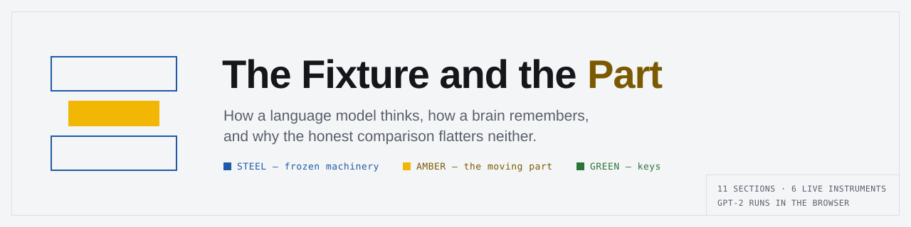
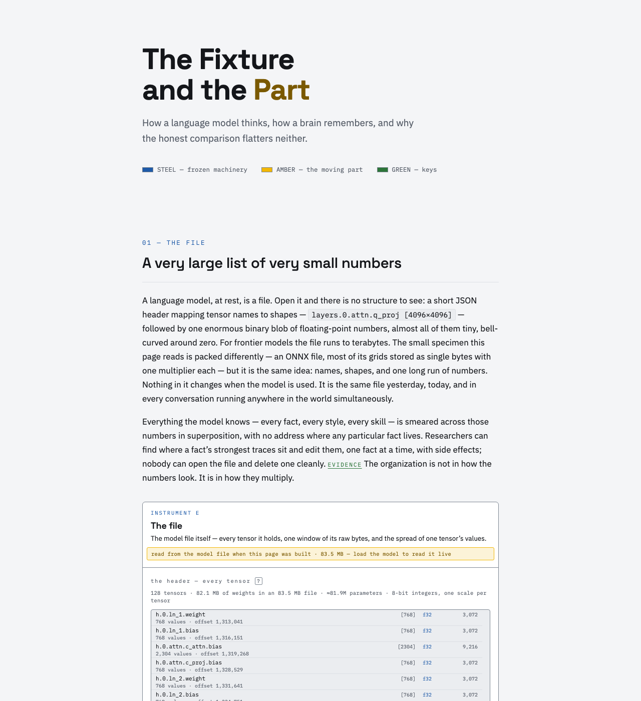
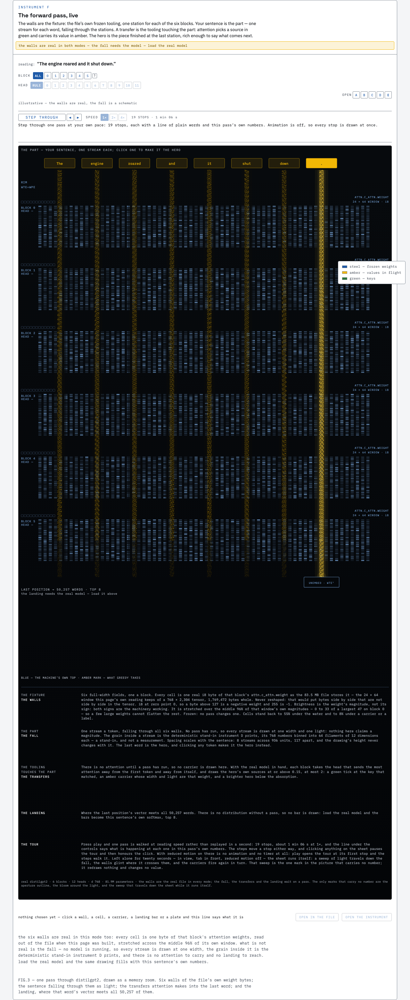

<p align="center"></p>

# The Fixture and the Part

*How a language model thinks, how a brain remembers, and why the honest comparison flatters neither.*

https://bill-viking.github.io/fixture-and-part/

## What it is

An interactive essay, drawn in the idiom of an engineering drawing. It runs to ten sections, and six of its figures are live instruments you can type into, step through and click. A real GPT-2 (`distilgpt2`, about 83 MB) can run in your browser: the page fetches it from huggingface.co only when you press its load button, runs it on WebGPU where the browser has it and on WASM where it does not, and sends nothing anywhere. With no model loaded, every number outside instrument E is an illustrative heuristic, and the page labels it so. Instrument E reads the real model file either way.

## What the name means

The essay's second section names the two halves of a running model after a machine shop:

> Weights are the tooling. Activations are the workpiece.
>
> These are the weights: machined once during training, then bolted down. A model in use never modifies them.
>
> What moves is the activation: one vector per token, thousands of numbers long, that represents that token in the text so far.

Three colours carry that thesis through every figure:

- **STEEL** — frozen machinery
- **AMBER** — the moving part
- **GREEN** — keys

## What it looks like



*The header and section 01, "The file", as the page renders them at 1280 pixels wide.*



*Instrument F, "The forward pass, live", in section 02, as the page renders it at 1280 pixels wide with reduced motion on and no model loaded (illustrative mode: the walls are the real file, the fall is a schematic).*

## The instruments

| | Instrument | Section | What it shows |
|---|---|---|---|
| E | The file | 01 — The file | the model file itself: every tensor, a window of its raw bytes, the spread of one tensor's values |
| A | The tokenizer | 02 — Fixture & part | the tokenizer strip: your sentence cut into the pieces the model reads |
| F | The forward pass, live | 02 — Fixture & part | a drawing of the whole model with your sentence running down through it |
| B | The forward pass and the KV rack | 03 — The moment | one forward pass per token, and the KV rack it leaves behind |
| C | The attention inspector | 04 — The lookup | which earlier tokens each head attends to, at a layer you pick |
| D | The glass pass | 04 — The lookup | the residual stream at one position, read through the logit lens |

## Run it on your machine

You need Node 20 or newer and npm. It was built with Node 26.7.0 and npm 11.19.0.

```
git clone https://github.com/Bill-Viking/fixture-and-part.git
cd fixture-and-part
npm install
npm run dev
```

Then open http://localhost:5173 in your browser.

On a Mac, `Start Fixture and Part.command` does the same on a double-click once the repository is installed; it expects the checkout at `/Users/bill/Projects/fixture-and-part`, so edit its `cd` line if yours lives elsewhere.

The real model loads from the page's own button: about 83 MB, downloaded once and cached by the browser after that.

`npm run build` writes the static site to `dist/`.
`npm run preview` serves that build locally.

## Deploy to GitHub Pages

`vite.config.js` reads the base path from `VITE_BASE`:

```
VITE_BASE=/fixture-and-part/ npm run build
```

Leading and trailing slashes are both required. For a user/org Pages site the
default base of `/` is correct and no env var is needed.

Before you publish, check the build: every path in `dist/index.html` must start with the base (`/fixture-and-part/`).

On Windows, build from PowerShell (`$env:VITE_BASE="/fixture-and-part/"; npm run build`), never from Git Bash, which rewrites the base into a Windows path and ships broken links.

## Inside

Spec: `interactive-guide-spec.md`.

### Layout

```
index.html
src/main.jsx
src/App.jsx                        section shell + shared instrument state
src/content/essay.js               all prose, per section, verbatim
src/content/explainers.js          the copy behind the "?" badges
src/content/claimNotes.js          the notes behind the essay's 21 claim marks
                                   — what each EVIDENCE / THEORY / ANALOGY
                                   claim rests on, and its sources; driven by
                                   components/ClaimNotes.jsx, mounted once
src/content/fileFacts.json         the model file, read ahead of time
src/instruments/FileView.jsx       E — the file            FIG.1     (section 01)
src/instruments/Tokenizer.jsx      A — tokenizer strip     FIG.2     (section 02)
src/instruments/ForwardMap.jsx     F — the forward pass,
                                       live                FIG.3     (section 02)
src/instruments/Stepper.jsx        B — forward pass + KV rack
                                                           FIG.4     (section 03)
src/instruments/AttentionInspector.jsx
                                   C — attention inspector FIG.5     (section 04)
src/instruments/GlassPass.jsx      D — residual stream + logit lens
                                                           FIG.6     (section 04)
src/lib/forwardMap.js              F — the architecture, band by band, and the
                                   three scalars per pass the drawing moves on
src/components/                    LoadNote, ModeControl, InfoTag, ClaimNotes,
                                   TeachPair, KVInspector, ReadingLine;
                                   usePopoverPlacement is the one placement
                                   law the two popovers share
src/lib/toyModel.js                Phase 1 heuristics
src/lib/realModel.js               transformers.js and distilgpt2, imported
                                   only when the reader asks for the real model
src/lib/onnxScan.js                the ONNX file, parsed — no DOM and no cache
                                   in it, so the same code runs in Node and in
                                   the worker
src/lib/modelBytesWorker.js        the one worker: the logit lens for D, and
                                   the manifest, windows and histograms for E
src/lib/workerHost.js              owns the worker handle, routes its replies
src/lib/logitLens.js               D's main-thread client
src/lib/fileBytes.js               E's main-thread client
src/lib/loadProgress.js            one wording for the download's progress
scripts/read-model-file.mjs        writes src/content/fileFacts.json
src/styles.css                     design tokens + all styling
```

Instruments A, B, C, D and F share one sequence, lifted into `App.jsx`: text
typed into A is tokenized, B appends generated tokens to it, C queries
whatever that sequence currently is, and D reads the stack at one position of
it. B, C, D and F each say which sentence they are reading, in one reserved
line at the top of the instrument, because A's input box is two or three
sections above them by the time they are on screen.

F shares more than the sequence, because it is a drawing of what the other
five are each looking at one piece of. It reads the same selected position as
D and the same selected layer as C, so moving either in one instrument moves
it in the other; its wall plates and its wall cells select a row in E; and the
token it names at the bottom is the token B is about to append. Its lettered markers scroll to
whichever instrument the part under them belongs to.

Nothing on F is a second implementation of anything. The columns are norms of
the residual stream D reads, the threads are the attention matrix C tabulates,
the shapes and byte counts are the manifest E lists, and `__mapCheck()` in a
dev build recomputes the two moving claims by a second route and prints the
largest disagreement it found.

E shares none of that sequence. It reads the file the other four run on. What
it takes from the page is whether the model has arrived in the browser yet, and
— so that it can answer the reader who changed the text and expected the file
to change with it — the text itself and the key of the run the model has
completed over it.

There is one worker, not two. D's lens and E's reads both want the same 83 MB
of model file, and a second worker would mean a second copy of it.

### Reading the model file

Instrument E shows the real `decoder_model_quantized.onnx` — the same file the
page downloads for real mode — and nothing on it is illustrative. So that it
can show it to a reader who has not downloaded anything,
`scripts/read-model-file.mjs` reads the file ahead of time and writes
`src/content/fileFacts.json`: every initializer with its dtype, shape, byte
length and absolute offset; a byte-exact distribution of each of them; and a
window of raw values out of every one — 24 rows by 64 columns for each of the
26 quantized weights, and the first 64 values of each of the 50 f32 norms and
biases. Provenance is recorded with it
— the URL, the sha256 and the date — and the script refuses to write facts
about a file that hashes to something else.

```
node scripts/read-model-file.mjs                     # downloads the file
node scripts/read-model-file.mjs --file model.onnx   # reads a local copy
node scripts/read-model-file.mjs --allow-new-sha     # the upload has changed
node scripts/read-model-file.mjs --tokenizer tokenizer.json  # a local tokenizer
```

For the word table the script also writes the mean and sd of each of its 768
columns over all 50,257 rows (`columnStats`), and the piece of text each of the
shipped window's 24 rows stands for (`rowLabels`), read from the model's own
`tokenizer.json` — whose sha256 is checked and recorded in `provenance` the way
the model file's is. The byte window labels itself from these, on its one
canvas: each row with its word piece (a position row as `p5`, any other
matrix's row by its number), every eighth slot over its column, and a key under
the cells painted by the same ramp and square-root law that paints them. A slot
is marked when its mean lies more than four sds of the 768 means from their
mean — slots 36 and 6 in the first 64 — and its words come from the same rule:
a slot whose own sd is under a twentieth of the median column sd "holds nearly
the same number for every word", any other "runs high" or "runs low" by the
sign of its mean (`standoutColumns` in `onnxScan.js`).

The word table's shipped window is not its first 24 rows but the 24 that hold
row 340, ` it` — the fifth token of the page's own sentence, the one word the
essay follows — so the window opens on rows 336–359, window 15 of 2,095
(every other tensor still opens on its first rows). That row is the lit row
(`litRow`): its label is `▶ ␣it` in the pick colour on whatever page shows
it, a plain sentence above the window says so, and once the model is loaded
the page tokenizes its own sentence again and checks that the fifth token is
that row. A row whose printed piece is the replacement glyph or a control
character — the 159 single raw bytes that are not a character on their own,
and the pieces holding half of a multi-byte character — prints the
vocabulary's own byte-level spelling instead (rows 240–255 read
`Ĵ ĵ Ķ … Ł ł Ń`), by one rule (`labelOf` in `src/lib/pieceLabel.js`) that the
script uses for the labels it ships and the page uses for every live one.

The JSON is committed, and imported dynamically so that it is its own chunk
rather than part of the initial bundle. Once the reader loads the real model
the worker re-reads all of it out of the copy in the browser, and the panel
says whether the two agree — fingerprint included; the word table's 768 + 768
column numbers are compared at 1e-4 and its 24 row labels against the model's
tokenizer, through the same line.

It goes back a second time. When the reader changes the sentence in instrument
A and the model runs on the new one, instrument E hashes the whole file again
and says what it found: the reader has just watched every other instrument
change and is entitled to know, at that moment, that this one did not. The
claim is a reading rather than a memory, which is why `readSha` in
`src/lib/fileBytes.js` is the one call in that module that is not cached.

### Design

The page is a white page ground with ink drawn on it. Dense fields of data —
instrument B's KV rack, instrument C's lookup table, instrument D's lens rows,
instrument E's byte window — are set into it on dark panels, the way a manual
sets a code block into a page. Everything else is ink and role colour on card.

The card is one twentieth of a stop off the page (`#FFFFFF` on `#F4F5F7`), so
nothing on this page may be identified by its fill: every card, callout, chip
and frame carries a drawn edge. Full token table and the rules that go with it:
`interactive-guide-spec.md` §3.

### Colour law

Three roles, and the tokens are named for the roles rather than for the colours
filling them, because the colours have now been repainted twice and the roles
have not:

- `--frozen` (the steel) is frozen machinery — weights, dies, anything that
  never changes.
- `--moving` (the amber) is the moving part — activations, tokens in flight,
  values.
- `--keys` (the green) is keys and searchable metadata.

This mapping is the visual thesis — do not swap it. `--alert` (red) is not one
of the roles; it is errors and warnings, used sparingly. The page's legend and
the essay's prose both call them the steel, the amber and the green; keep the
two in step.

Three rules follow from the ground being light. Yellow is a fill and never
body-size text on the page ground, so anything that has to be read in the
moving-part role takes `--moving-ink`. What is written on top of a full yellow
fill takes `--moving-on`, which is a token so that a future repaint stays a
swap of the table. And a role colour on a dark panel is not the same swatch as
on the page ground: `--frozen-on-screen` and `--keys-on-screen` are the only
forms of those two allowed there.

---

Drafted August 2026, from a conversation between Bill (Seattle) and Claude (Anthropic).
